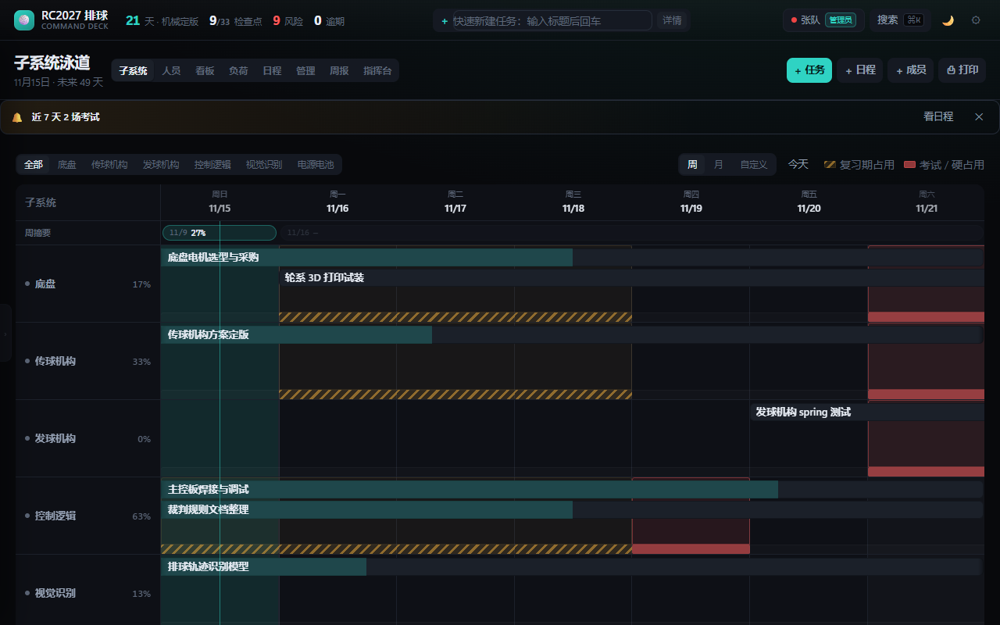

# RC2027 排球 · 进度指挥台

一个给 ROBOCON 小队用的比赛进度看板：**单文件网页**，双击就能开，不需要服务器、不需要登录后台。默认数据只存在你自己浏览器里，配上 Supabase 后全队共用同一份。

在线版：`https://<你的用户名>.github.io/<仓库名>/`



## 能做什么

- **泳道甘特**：子系统 / 人员两条视角，任务条可拖动改期、拖边界改时长，自动错行不重叠
- **占用带**：考试、复习期、固定课程按人铺在时间轴上；复习期按每个人的节奏（提前几天、强度、冲刺曲线）自动生成
- **看板**：拖拽换状态，卡片上直接看检查点进度、协作、延续期
- **负荷热力图**：人 × 日剩余精力，周 / 月 / 自定义三种尺度；点格子直接补记考试或占用
- **日程**：考试与事件（可周期性），按人设复习节奏、单独覆盖
- **管理**：批量改状态 / 负责人 / 平移日期（带 diff 预览），快捷布置任务
- **周报**：本周进度 → 自动折算检查点；归档成周摘要；可一键整理成群消息；可选接 DeepSeek 生成周报
- **指挥台**：数据自检、字典、风险规则、导入导出、变更记录

### 排期与协同

- 排期方式：固定日期 / **在某任务之后开始** / **与某任务同时进行**，参照任务一改，后面自动级联
- **延续优化期**：验收 DDL 过后还能继续打磨，期间不标逾期，显示「延续优化中 · 还剩 N 天」
- **跨子系统协作**：负责人可向其他子系统发起对接申请，对方接受 / 拒绝，左栏和任务气泡都有提醒

## 怎么用

1. 打开网页（本地双击 `index.html` 或访问 GitHub Pages 地址）
2. 第一次打开会要求建一个管理员账号（名字 + 4–6 位 PIN），账号只存在本机浏览器
3. 内置一份 5 人 / 10 任务的示例数据，直接改或清空重建

## 多人共享（可选 · 云同步）

默认是「各人各存」。要让全队看同一份数据，接一个 Supabase 免费项目（约 5 分钟）：

1. 在 [supabase.com](https://supabase.com) 新建项目 → **SQL Editor** 里执行：

```sql
create table if not exists public.rc_state (
  room text primary key,
  data jsonb not null,
  rev bigint not null default 1,
  updated_at timestamptz not null default now(),
  updated_by text
);

alter table public.rc_state enable row level security;

create policy "team read"   on public.rc_state for select using (true);
create policy "team insert" on public.rc_state for insert with check (true);
create policy "team update" on public.rc_state for update using (true) with check (true);

grant usage on schema public to anon, authenticated;
grant select, insert, update on table public.rc_state to anon, authenticated;
```

2. 每个人打开网页 → 点顶栏 **「未同步」** → 填 Project URL 与 publishable key（`sb_publishable_...`）→ 保存。
3. 已经有数据的人点「立即上传」；加入的人选「用云端覆盖本机」。
4. 之后改动 800ms 自动上传；每 20 秒检查云端，别人改了会弹「云端有更新」，撞车会弹「同步冲突」让你选保留哪边。

细节见仓库外的《使用说明.md》。**publishable key 是公开的**，可以放在网页里；绝不要用 `service_role` / `sb_secret_` 开头的密钥。

## 数据在哪

- 默认全部数据存在浏览器的 `localStorage`（键名 `rc2027_progress_v1`）
- 配了云同步 → 云端 `public.rc_state` 里一份 JSON（AI Key 不会上传）
- 换浏览器 / 清缓存会丢，迁移可在「指挥台 → 导入导出」里导出 JSON 再导入
- 没配云同步时，别人打开网页看到的是**示例数据**，不是你的团队数据

## 本地开发

源码是同目录上一级的 `_app2.js` + `_shell.html`：

```bash
node _chk.cjs _app2.js   # 语法检查
node _build.cjs          # 生成 index.html
```

## 说明

- 纯前端、零依赖、零构建工具，就一个 HTML 文件
- 账号 PIN 只用于区分权限，不能防止懂开发者工具的人查看数据；别把敏感信息写进去
- AI 周报需要自备 API Key，Key 只存在本机浏览器，不会进仓库
